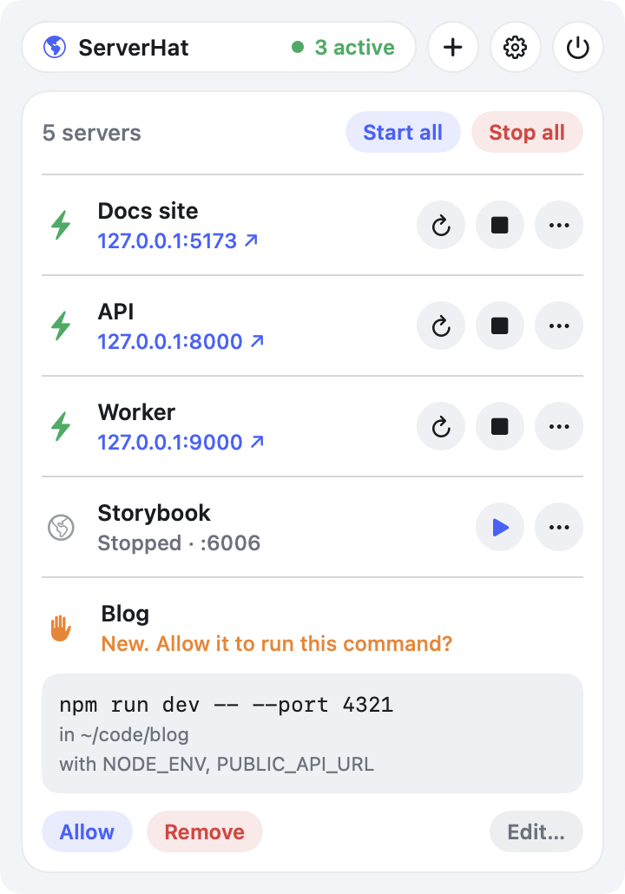
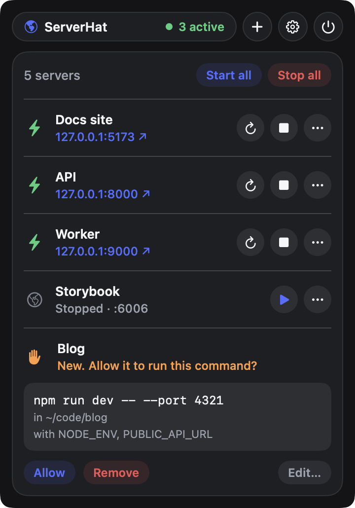
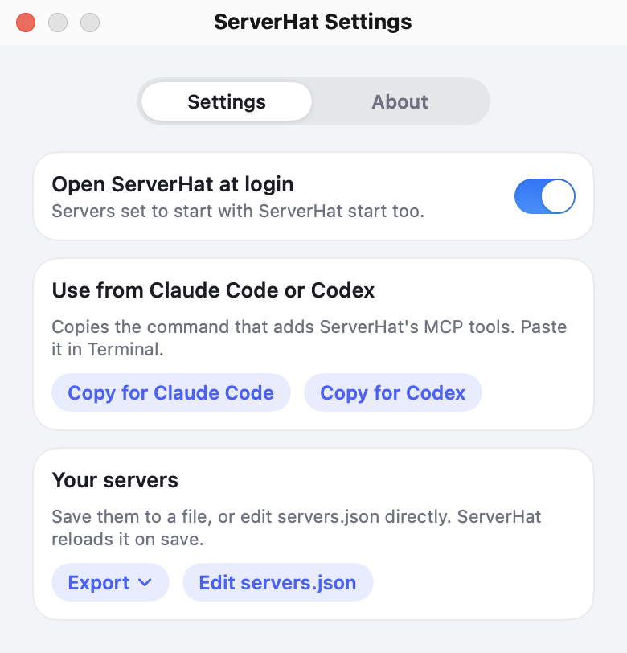

# ServerHat

**Your local web servers, one click away in the Mac menu bar. Free and open source.**

No account, no analytics, nothing leaves your Mac.

ServerHat starts, stops, restarts and opens the little web servers you run while you
work (a Node script, `npm run dev`, `python3 -m http.server`, anything with a command
line), so you never have to keep a Terminal tab open for them. It also has a local API,
so Claude Code, Codex or your own scripts can add and control servers for you.

 

## What it does

- A globe in the menu bar, with a list of your servers. Each shows whether it's
  **starting**, **ready**, **unhealthy**, **stopped**, **crashed** or has its **port in use**, and has Start/Stop,
  Restart, Open in browser and View logs. Starting a server from the menu (or allowing
  one) opens it in your browser once it's up. A running server shows its address as a
  link. **Start all** and **Stop all** are in the Servers row when you have more than one.
- Notices when a server crashes (and shows its last line of output) and when its port is
  already taken by something else (and which process that is).
- Keeps a log per server, in the app and in `~/Library/Logs/ServerHat/<id>.log`.
- Stores everything in one readable JSON file and picks up edits to it immediately.
- Exports the server list as JSON, with the option to omit environment values.
- Imports servers from Claude Code's `.claude/launch.json`.
- Imports a project command from `package.json` (`dev`, or `start`), a `web:` Procfile entry, or Docker Compose.
- Optionally retries a server after a crash, with exponential backoff and a retry limit.
- Runs commands with the same `PATH` your login shell sets up (Homebrew, nvm, and so on),
  in their own process group, so Stop also ends whatever the server started.
- Quitting ServerHat stops the servers it started.

## Download

### macOS 13 or later, Apple silicon (M1 and newer) only

With [Homebrew](https://brew.sh):

```sh
brew install --cask getguruhat/tap/serverhat
```

Or download `ServerHat-<version>-Installer.dmg` from the [latest release](../../releases/latest),
open it, and drag `ServerHat.app` onto Applications.

The app isn't notarized by Apple, so macOS blocks the first launch. Open **System Settings ›
Privacy & Security** and click **Open Anyway** (once). ServerHat is open source: you can
read every line or [build it yourself](#build-from-source).

### Windows

See [ServerHat for Windows](https://github.com/getguruhat/serverhat-windows).

## The config file

`~/Library/Application Support/ServerHat/servers.json`:

```json
{
  "servers" : [
    {
      "args" : ["ai-experts/server.mjs"],
      "command" : "node",
      "cwd" : "~/Developer",
      "env" : {},
      "id" : "ai-experts",
      "name" : "AI Experts",
      "port" : 4319,
      "startAtLogin" : false,
      "url" : "http://127.0.0.1:4319"
    }
  ],
  "version" : 1
}
```

| Field | Required | Meaning |
| --- | --- | --- |
| `id` | no | Short unique name used by the API and for the log file. Made from `name` if left out. |
| `name` | yes | What the menu shows. |
| `cwd` | no | Folder the command runs in. `~` works. Defaults to your home folder. |
| `command` | yes | A program on your shell's `PATH` (`node`, `npm`, `python3`) or a path to one. It is run directly, not through a shell, so no pipes or `&&`. |
| `args` | no | Arguments, one string each. |
| `port` | no | The port the server listens on. ServerHat uses it to detect port conflicts and, without an HTTP URL, to tell "starting" from "running". |
| `url` | no | What Open in browser opens. Defaults to `http://127.0.0.1:<port>`. |
| `healthContains` | no | Optional text that must appear in the configured URL's HTTP response body before ServerHat reports the app ready. |
| `env` | no | Extra environment variables, `{"NAME": "value"}`. |
| `startAtLogin` | no | Start this server whenever ServerHat starts. Turn on **Open ServerHat at login** (in Settings, the gear in the menu) to have that happen at login. |
| `restartOnCrash` | no | Retry after an unexpected non-zero exit. Off by default. |
| `restartLimit` | no | Maximum automatic retries before giving up (1–10, default 3). Delay doubles between attempts, up to 30 seconds. |

Save the file and ServerHat reloads it within a second. If the JSON is broken, the menu
says where, and the last good settings stay in use. A server that's running keeps its old
settings until you restart it. Removing a server from the file stops it.

Use **Settings › Export › Export servers…** to save a portable JSON copy. Environment values are omitted
by default; choose the separate **Export with environment values…** action only
when you intend to include them, and protect that file accordingly.

## Import from `.claude/launch.json`

Choose **+ › Import .claude/launch.json…** and pick a project folder or its
`.claude/launch.json`. Each configuration
(`{name, runtimeExecutable, runtimeArgs, port, url}`) becomes a server that runs from the
project folder. Configurations that are already in ServerHat are skipped.

## Import a project

Choose **+ › Import project…** and select a project folder. ServerHat prefers the `dev`
script (or `start` if there is no `dev` script) in `package.json`, a `web:` command in
`Procfile`, or a Docker Compose file. It infers a port when the command declares one.
Duplicate commands from the same folder are skipped. The API exposes this as
`POST /v1/import-project`, and MCP clients can use `import_project`.

## Use it from Claude Code and Codex (MCP)

ServerHat has a built-in MCP server, so AI coding agents get it as tools instead of
having to call the API with curl. Open Settings (the gear in the menu), choose **Copy for Claude
Code** (or **Copy for Codex**) and paste the command into Terminal. It looks like:



```sh
claude mcp add --scope user serverhat -- /Applications/ServerHat.app/Contents/MacOS/ServerHat --mcp
codex mcp add serverhat -- /Applications/ServerHat.app/Contents/MacOS/ServerHat --mcp
```

These commands configure the **Claude Code CLI** and **Codex CLI**. The matching CLI
must already be installed and available in Terminal's `PATH`; installing the Claude or
Codex desktop app does not necessarily install its command-line tool. Check with
`command -v claude` or `command -v codex`.

To install the CLIs with npm (Node.js is required):

```sh
npm install -g @anthropic-ai/claude-code
npm install -g @openai/codex@latest
```

See the [Claude Code setup guide](https://docs.anthropic.com/en/docs/claude-code/getting-started)
and [Codex CLI documentation](https://developers.openai.com/codex/cli) for other install
methods and troubleshooting. After installation, open a new Terminal window, verify the
command is found, then run the matching ServerHat setup command above.

The agent then has `list_servers`, `get_server`, `start_server`, `stop_server`,
`restart_server`, `get_logs`, `add_server`, `update_server`, `remove_server`,
`import_launch_json` and `import_project`. Start and restart wait until the server is running or has failed,
and a failure comes back with the server's last lines of output. A server an agent adds or
changes waits for you to allow it first (see [Approval](#approval)).

`ServerHat --mcp` speaks MCP over stdin and stdout and drives the running app through
the API below. It opens ServerHat if it isn't running, and it reads the token from the
token file itself, so the token never goes into an MCP config.

## API

ServerHat listens on `http://127.0.0.1:47317` (only on this Mac). Change the port with
`defaults write com.guruhat.serverhat apiPort -int 47400` and restart ServerHat.

`~/Library/Application Support/ServerHat/api.json` says where the API is and where its
token is:

```json
{ "url": "http://127.0.0.1:47317", "tokenFile": "~/Library/Application Support/ServerHat/api-token", "configFile": "…/servers.json" }
```

### Security

- Every request except `GET /v1/health` needs `Authorization: Bearer <token>`. The token
  is created on first launch in `api-token`, readable only by you (mode 600, in a folder
  with mode 700). Delete the file and restart ServerHat to get a new one.
- The `Host` header must be `127.0.0.1:<port>` or `localhost:<port>`, which blocks DNS
  rebinding.
- Requests that carry an `Origin` header, or a `Sec-Fetch-Site` other than `none`, are
  refused, and CORS preflights are refused, so web pages can't use the API.
- Request bodies must be JSON with `Content-Type: application/json`, at most 1 MB.

Anyone holding the token can change what ServerHat runs. Keep it out of repositories and
logs.

### Approval

A server added through the API or MCP, or by editing `servers.json`, can't start until
you allow it. The same goes for an existing server whose `command`, `args`, `cwd` or
`env` changes (name, port, url and `startAtLogin` don't count). ServerHat sends one
notification for each pending command fingerprint; it shows the command and folder, and
clicking it opens **Allow**, **Remove** and **Later** choices. The menu shows the server
with its full command, folder and environment names, and **Allow** and **Remove** buttons. Servers you add or edit in ServerHat's own
windows, or import from the menu's **+** button, count as allowed. So do the servers you
already had when you updated to a version with approvals.

Until you allow it, `start` and `restart` answer `403` with an explanation. Add
`?wait=<seconds>` and they wait that long for you to click Allow, then go ahead. A
server waiting for you has `"needsApproval": true` in API responses. ServerHat keeps what
you've allowed in its preferences, not in `servers.json`.

### Notifications

ServerHat sends a macOS notification when a server crashes (click it to see the log) and
when a server is waiting for your approval (click it to review and allow it). macOS asks
for permission the first time. Turn them off in System Settings › Notifications.

### Setup for the examples

```sh
LW=http://127.0.0.1:47317
TOKEN=$(cat ~/Library/Application\ Support/ServerHat/api-token)
auth=(-H "Authorization: Bearer $TOKEN" -H "Content-Type: application/json")
```

### Endpoints

| Method and path | Does |
| --- | --- |
| `GET /v1/health` | `{"ok": true}` without a token; shows ServerHat is running. |
| `GET /v1/servers` | All servers with their status. |
| `POST /v1/servers` | Add a server. Body: the fields above. Returns it with `201`, or `409` if the id is taken. |
| `GET /v1/servers/{id}` | One server with its status. |
| `PATCH /v1/servers/{id}` | Change some fields. `null` clears `port` or `url`. |
| `PUT /v1/servers/{id}` | Replace all fields. |
| `DELETE /v1/servers/{id}` | Stop and remove a server. |
| `POST /v1/servers/{id}/start` | Start it. `409` if its port is already in use. |
| `POST /v1/servers/{id}/stop` | Stop it (SIGTERM to its process group, SIGKILL after 5 s). |
| `POST /v1/servers/{id}/restart` | Stop it, then start it again. |
| `GET /v1/servers/{id}/logs?lines=200` | The last lines of its output (up to 5000), plus the log file path. |
| `POST /v1/start-all`, `POST /v1/stop-all` | Start or stop every server. |
| `POST /v1/import` | Body `{"path": "<project folder or launch.json>"}`. Returns `{"added": [...]}`. |
| `POST /v1/import-project` | Body `{"path": "<project folder>"}`. Imports a detected local web command. |
| `POST /v1/reload` | Re-read `servers.json` now. |

Add `?wait=<seconds>` (up to 60) to start, stop and restart to get the answer once the
server is running, stopped or has failed, instead of right away.

Each server in a response has its settings plus:

```json
"status": { "state": "running", "pid": 8101, "startedAt": "2026-10-30T23:06:47Z" },
"log": "/Users/you/Library/Logs/ServerHat/ai-experts.log",
"openURL": "http://127.0.0.1:4319"
```

`state` is one of `stopped`, `starting` (waiting for TCP or HTTP readiness), `running`
(the configured HTTP URL returned 2xx, or the TCP port is open), `unhealthy` (the process
is alive but HTTP readiness timed out/failed or an uncaught Python/Streamlit exception appeared
in its output), `stopping`, `crashed` (exited with an error; see `detail` and `exitCode`), `port-in-use`
(something else holds the port; `detail` and `pid` name it) or `failed` (couldn't be
launched, for example command not found). Errors come back as `{"error": "…"}` with a
4xx status.

### Examples

```sh
# Add a server and start it, waiting until it's listening
curl -s "${auth[@]}" -X POST $LW/v1/servers -d '{
  "name": "Docs preview", "cwd": "~/code/docs", "command": "npm",
  "args": ["run", "dev"], "port": 5173, "env": {"BROWSER": "none"}
}'
curl -s "${auth[@]}" -X POST "$LW/v1/servers/docs-preview/start?wait=30"

# What's running?
curl -s "${auth[@]}" $LW/v1/servers

# Why did it crash?
curl -s "${auth[@]}" "$LW/v1/servers/docs-preview/logs?lines=50"

# Change the port, then restart
curl -s "${auth[@]}" -X PATCH $LW/v1/servers/docs-preview -d '{"port": 5174}'
curl -s "${auth[@]}" -X POST "$LW/v1/servers/docs-preview/restart?wait=30"

# Import a project's .claude/launch.json
curl -s "${auth[@]}" -X POST $LW/v1/import -d '{"path": "~/code/docs"}'
```

## Build from source

Requires macOS 13 or later and Swift 5.9 or later (Xcode or the Command Line Tools).

```sh
./build-app.sh            # builds ServerHat.app and ServerHat-Installer.dmg
./build-app.sh --no-dmg   # just the app
open ServerHat.app
```

`swift make-icon.swift` redraws `icon.png` and `AppIcon.icns`.

`swift test` runs the tests: the API's token, Host and Origin checks, request parsing,
approval fingerprints, the servers.json format and the importers. They never touch your
own servers or settings.

Before publishing a release, run `./release-check.sh`. It runs the tests, installs the app
from the DMG into a temporary folder, checks its version, signature and icon, and opens the
Settings window there with an empty server list. It fails if a tab doesn't fit, and leaves
screenshots of each tab and of the menu in `release-check/` for you to look at.

The pictures in `docs/` come from the same `--snapshot`, run with a `servers.json` of
example servers in `SERVERHAT_SUPPORT_FOLDER`. Servers set to start at login start first,
and are stopped again before it exits.

The code is in `Sources/ServerHat/`:

- `Config.swift`: the servers.json format, the file watcher, and the launch.json importer.
- `ServerManager.swift`: starting and stopping processes, logs, crash and port detection.
- `APIServer.swift`: the local HTTP API.
- `MCPServer.swift`: the MCP server that `ServerHat --mcp` runs.
- `Notifier.swift`: crash and approval notifications.
- `UpdateChecker.swift`: the daily check for a newer GitHub release.
- `main.swift`: the menu, and the log, edit and Settings windows.
- `Snapshot.swift`: the Settings and menu screenshots for `release-check.sh` and `docs/` (`ServerHat --snapshot`).

## Problems and ideas

Found a bug or want something? [Open an issue](https://github.com/getguruhat/serverhat-macos/issues), or ask in [Discussions](https://github.com/getguruhat/serverhat-macos/discussions).
ServerHat collects no analytics, so issues are the only way we hear about problems.

## Support

ServerHat is free. If it saves you time, you can
[support GuruHat with a donation](https://www.paypal.com/donate/?hosted_button_id=FHGYWD46722JS).

## License

MIT. See [LICENSE](LICENSE).

Guide: [How to let Claude Code and Codex run your local dev servers](https://guruhat.com/guides/run-dev-servers-claude-code-codex-mcp/). More at [guruhat.com/apps/serverhat](https://guruhat.com/apps/serverhat/).
